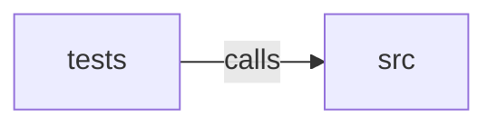

_Generated by CodeAtlas._

## Details

Owns 0 symbols across 1 file(s).

### src

Owns 85 symbols across 5 file(s).

**Related Classes/Methods:** _None_

**Source Files:**

- `crates/core/src/analyzer.rs`
  - `crates.core.src.analyzer.AnalysisContext`
  - `crates.core.src.analyzer.AnalysisResult`
  - `crates.core.src.analyzer.AnalysisResult.critical_findings`
  - `crates.core.src.analyzer.AnalysisResult.high_findings`
  - `crates.core.src.analyzer.AnalysisResult.total_score`
  - `crates.core.src.analyzer.Analyzer`
  - `crates.core.src.analyzer.DataProfile`
  - `crates.core.src.analyzer.Finding`
  - `crates.core.src.analyzer.FindingType`
  - `crates.core.src.analyzer.Impact`
  - `crates.core.src.analyzer.RiskSeverity`
  - `crates.core.src.analyzer.RiskSeverity.score`
- `crates/core/src/ir.rs`
  - `crates.core.src.ir.DeploymentConfig`
  - `crates.core.src.ir.Edge`
  - `crates.core.src.ir.PipelineIR`
  - `crates.core.src.ir.PipelineIR.get_downstream_nodes`
  - `crates.core.src.ir.PipelineIR.get_node`
  - `crates.core.src.ir.PipelineIR.get_sink_nodes`
  - `crates.core.src.ir.PipelineIR.get_source_nodes`
  - `crates.core.src.ir.PipelineIR.get_upstream_nodes`
  - `crates.core.src.ir.PipelineIR.new`
  - `crates.core.src.ir.PipelineMetadata`
  - `crates.core.src.ir.Runner`
  - `crates.core.src.ir.TransformNode`
  - `crates.core.src.ir.TransformType`
  - `crates.core.src.ir.TransformType.is_shuffle_operation`
  - `crates.core.src.ir.TransformType.is_stateful`
- `crates/core/src/lib.rs`
  - `crates.core.src.lib.analyze_flink_pipeline`
  - `crates.core.src.lib.analyze_pipeline`
  - `crates.core.src.lib.analyze_pipeline_with_rules`
  - `crates.core.src.lib.analyze_spark_pipeline`
  - `crates.core.src.lib.analyze_spark_pipeline_with_rules`
  - `crates.core.src.lib.run_analyzers`
- `crates/core/src/parser.rs`
  - `crates.core.src.parser.BeamPipelineParser`
  - `crates.core.src.parser.BeamPipelineParser.add_cogroupbykey_transform`
  - `crates.core.src.parser.BeamPipelineParser.add_combineperkey_transform`
  - `crates.core.src.parser.BeamPipelineParser.add_flatten_transform`
  - `crates.core.src.parser.BeamPipelineParser.add_groupbykey_transform`
  - `crates.core.src.parser.BeamPipelineParser.add_pardo_transform`
  - `crates.core.src.parser.BeamPipelineParser.add_partition_transform`
  - `crates.core.src.parser.BeamPipelineParser.add_sink_transform`
  - `crates.core.src.parser.BeamPipelineParser.add_source_transform`
  - `crates.core.src.parser.BeamPipelineParser.add_windowing_transform`
  - `crates.core.src.parser.BeamPipelineParser.build_edges`
  - `crates.core.src.parser.BeamPipelineParser.default`
  - `crates.core.src.parser.BeamPipelineParser.extract_allowed_lateness`
  - `crates.core.src.parser.BeamPipelineParser.extract_dofn_name`
  - `crates.core.src.parser.BeamPipelineParser.extract_duration`
  - `crates.core.src.parser.BeamPipelineParser.extract_key_expr`
  - `crates.core.src.parser.BeamPipelineParser.extract_transforms`
  - `crates.core.src.parser.BeamPipelineParser.extract_var_name`
  - `crates.core.src.parser.BeamPipelineParser.generate_id`
  - `crates.core.src.parser.BeamPipelineParser.new`
  - `crates.core.src.parser.BeamPipelineParser.parse`
  - `crates.core.src.parser.PatternCache`
  - `crates.core.src.parser.PatternCache.new`
  - `crates.core.src.parser.tests.test_build_edges_connects_nodes_sequentially`
  - `crates.core.src.parser.tests.test_parse_detects_each_sink_type`
  - `crates.core.src.parser.tests.test_parse_detects_each_source_type`
  - `crates.core.src.parser.tests.test_parse_detects_flatten_and_partition`
  - `crates.core.src.parser.tests.test_parse_detects_global_windows`
  - `crates.core.src.parser.tests.test_parse_detects_groupby_combine_cogroup`
  - `crates.core.src.parser.tests.test_parse_pardo_flags_stateful_and_side_inputs`
  - `crates.core.src.parser.tests.test_parse_realistic_pipeline_detects_all_stages_in_order`
  - `crates.core.src.parser.tests.test_parse_rejects_code_without_beam_import`
  - `crates.core.src.parser.tests.test_parse_simple_pipeline`
  - `crates.core.src.parser.tests.test_parse_skips_comments_and_blank_lines`
  - `crates.core.src.parser.tests.test_parse_windowing_distinguishes_sliding_and_session`
  - `crates.core.src.parser.tests.test_parse_windowing_extracts_type_duration_and_lateness`
- `crates/core/src/rules.rs`
  - `crates.core.src.rules.CostRules`
  - `crates.core.src.rules.CostRules.default`
  - `crates.core.src.rules.HotKeyRules`
  - `crates.core.src.rules.HotKeyRules.default`
  - `crates.core.src.rules.RulesConfig`
  - `crates.core.src.rules.RulesConfig.load_from_file`
  - `crates.core.src.rules.RulesConfig.load_from_str`
  - `crates.core.src.rules.SparkJoinRules`
  - `crates.core.src.rules.SparkJoinRules.default`
  - `crates.core.src.rules.StateRules`
  - `crates.core.src.rules.StateRules.default`
  - `crates.core.src.rules.tests.test_default_matches_previously_hardcoded_values`
  - `crates.core.src.rules.tests.test_empty_yaml_is_all_defaults`
  - `crates.core.src.rules.tests.test_full_override_all_sections`
  - `crates.core.src.rules.tests.test_invalid_yaml_is_a_real_error`
  - `crates.core.src.rules.tests.test_partial_override_keeps_other_fields_at_default`

### tests

Owns 15 symbols across 1 file(s).

**Related Classes/Methods:** _None_

**Source Files:**

- `crates/core/tests/integration.rs`
  - `crates.core.tests.integration.analyze_flink_pipeline_realistic_source_end_to_end`
  - `crates.core.tests.integration.analyze_flink_pipeline_rejects_non_flink_source`
  - `crates.core.tests.integration.analyze_pipeline_empty_source_does_not_panic`
  - `crates.core.tests.integration.analyze_pipeline_extremely_long_single_line_does_not_panic`
  - `crates.core.tests.integration.analyze_pipeline_handles_unicode_and_pathological_content_without_panicking`
  - `crates.core.tests.integration.analyze_pipeline_malformed_data_profile_json_is_a_clean_error`
  - `crates.core.tests.integration.analyze_pipeline_non_beam_source_does_not_panic`
  - `crates.core.tests.integration.analyze_pipeline_realistic_streaming_source_end_to_end`
  - `crates.core.tests.integration.analyze_pipeline_with_data_profile_end_to_end`
  - `crates.core.tests.integration.analyze_spark_pipeline_realistic_source_end_to_end`
  - `crates.core.tests.integration.analyze_spark_pipeline_rejects_non_spark_source`
  - `crates.core.tests.integration.beam_global_windows_without_trigger_flagged_end_to_end`
  - `crates.core.tests.integration.custom_hotkey_rules_yaml_changes_beam_analysis_end_to_end`
  - `crates.core.tests.integration.custom_spark_join_rules_yaml_changes_spark_analysis_end_to_end`
  - `crates.core.tests.integration.text_report_overall_risk_score_label_is_not_ambiguous`
