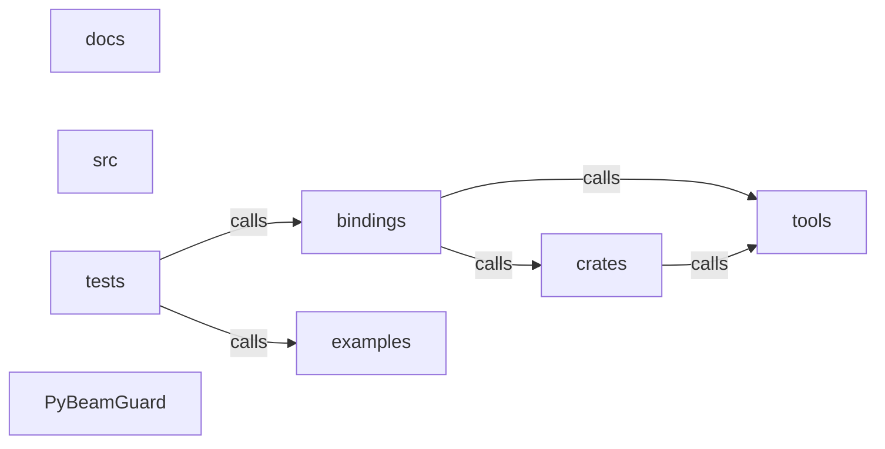

_Generated by CodeAtlas._

## Details

Architecture map of PyBeamGuard.

### bindings

Owns 0 symbols across 0 file(s).

**Related Classes/Methods:** _None_

### crates

Owns 0 symbols across 0 file(s).

**Related Classes/Methods:** _None_

### docs

Owns 0 symbols across 0 file(s).

**Related Classes/Methods:** _None_

### examples

Owns 3 symbols across 1 file(s).

**Related Classes/Methods:** _None_

**Source Files:**

- `examples/pipeline_simple.py`
  - `examples.pipeline_simple.ParseFn`
  - `examples.pipeline_simple.ParseFn.process`
  - `examples.pipeline_simple.run`

### src

Owns 0 symbols across 0 file(s).

**Related Classes/Methods:** _None_

### tests

Owns 29 symbols across 2 file(s).

**Related Classes/Methods:** _None_

**Source Files:**

- `tests/test_codeatlas_adapter.py`
  - `tests.test_codeatlas_adapter._run`
  - `tests.test_codeatlas_adapter.test_check_reports_the_embedded_engine_available`
  - `tests.test_codeatlas_adapter.test_diagnose_summarises_the_architecture_map`
  - `tests.test_codeatlas_adapter.test_explain_reports_an_unknown_node_as_an_error`
  - `tests.test_codeatlas_adapter.test_god_nodes_are_ranked_by_degree`
- `tests/test_python_bindings.py`
  - `tests.test_python_bindings.TestCliMain`
  - `tests.test_python_bindings.TestCliMain.test_analyze_empty_pipeline_file_is_clean_error`
  - `tests.test_python_bindings.TestCliMain.test_analyze_fail_on_triggers_nonzero_exit`
  - `tests.test_python_bindings.TestCliMain.test_analyze_json_format`
  - `tests.test_python_bindings.TestCliMain.test_analyze_malformed_data_profile_is_clean_error`
  - `tests.test_python_bindings.TestCliMain.test_analyze_missing_file_is_clean_error`
  - `tests.test_python_bindings.TestCliMain.test_analyze_missing_rules_file_is_clean_error`
  - `tests.test_python_bindings.TestCliMain.test_analyze_rules_flag_ignored_with_flink_framework`
  - `tests.test_python_bindings.TestCliMain.test_analyze_text_format`
  - `tests.test_python_bindings.TestCliMain.test_analyze_with_rules_yaml_changes_output`
  - `tests.test_python_bindings.TestCliMain.test_help_with_no_args`
  - `tests.test_python_bindings.TestCliMain.test_version_flag`
  - `tests.test_python_bindings.test_analyze_structured_empty_source_raises_not_panics`
  - `tests.test_python_bindings.test_analyze_structured_rejects_malformed_data_profile`
  - `tests.test_python_bindings.test_analyze_structured_rejects_malformed_rules_yaml`
  - `tests.test_python_bindings.test_analyze_structured_rejects_non_beam_source`
  - `tests.test_python_bindings.test_analyze_structured_runs_all_analyzers`
  - `tests.test_python_bindings.test_analyze_structured_with_data_profile_changes_output`
  - `tests.test_python_bindings.test_analyze_structured_with_rules_yaml_changes_output`
  - `tests.test_python_bindings.test_console_script_entry_point_end_to_end`
  - `tests.test_python_bindings.test_example_pipeline_file_analyzes_successfully`
  - `tests.test_python_bindings.test_get_text_report_and_get_json_report`
  - `tests.test_python_bindings.test_native_module_is_available`
  - `tests.test_python_bindings.test_python_shim_version_matches_installed_package_metadata`

### tools

Owns 0 symbols across 0 file(s).

**Related Classes/Methods:** _None_

### PyBeamGuard

Owns 0 symbols across 11 file(s).

**Related Classes/Methods:** _None_
