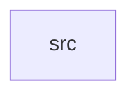

_Generated by CodeAtlas._

## Details

Owns 0 symbols across 1 file(s).

### src

Owns 159 symbols across 1 file(s).

**Related Classes/Methods:** _None_

**Source Files:**

- `bindings/python/src/lib.rs`
  - `bindings.python.src.lib.PyAnalysisResult`
  - `bindings.python.src.lib.PyAnalysisResult.__repr__`
  - `bindings.python.src.lib.PyAnalysisResult.critical_findings`
  - `bindings.python.src.lib.PyAnalysisResult.finding_count`
  - `bindings.python.src.lib.PyAnalysisResult.get_analyzer_name`
  - `bindings.python.src.lib.PyAnalysisResult.get_confidence`
  - `bindings.python.src.lib.PyAnalysisResult.get_findings`
  - `bindings.python.src.lib.PyAnalysisResult.get_metrics`
  - `bindings.python.src.lib.PyAnalysisResult.get_summary`
  - `bindings.python.src.lib.PyAnalysisResult.get_version`
  - `bindings.python.src.lib.PyAnalysisResult.high_findings`
  - `bindings.python.src.lib.PyAnalysisResult.total_score`
  - `bindings.python.src.lib.PyAnalyzerInfo`
  - `bindings.python.src.lib.PyAnalyzerInfo.__repr__`
  - `bindings.python.src.lib.PyAnalyzerInfo.get_name`
  - `bindings.python.src.lib.PyAnalyzerInfo.get_priority`
  - `bindings.python.src.lib.PyAnalyzerInfo.get_version`
  - `bindings.python.src.lib.PyAnalyzerPerformance`
  - `bindings.python.src.lib.PyAnalyzerPerformance.__repr__`
  - `bindings.python.src.lib.PyAnalyzerPerformance.get_analyzer_name`
  - `bindings.python.src.lib.PyAnalyzerPerformance.get_avg_confidence`
  - `bindings.python.src.lib.PyAnalyzerPerformance.get_finding_count`
  - `bindings.python.src.lib.PyAnalyzerPerformance.get_total_impact_score`
  - `bindings.python.src.lib.PyAnalyzerRanking`
  - `bindings.python.src.lib.PyAnalyzerRanking.__repr__`
  - `bindings.python.src.lib.PyAnalyzerRanking.get_analyzer_name`
  - `bindings.python.src.lib.PyAnalyzerRanking.get_avg_confidence`
  - `bindings.python.src.lib.PyAnalyzerRanking.get_finding_count`
  - `bindings.python.src.lib.PyFinding`
  - `bindings.python.src.lib.PyFinding.__repr__`
  - `bindings.python.src.lib.PyFinding.get_affected_nodes`
  - `bindings.python.src.lib.PyFinding.get_confidence`
  - `bindings.python.src.lib.PyFinding.get_description`
  - `bindings.python.src.lib.PyFinding.get_estimated_impact`
  - `bindings.python.src.lib.PyFinding.get_id`
  - `bindings.python.src.lib.PyFinding.get_recommendation`
  - `bindings.python.src.lib.PyFinding.get_severity`
  - `bindings.python.src.lib.PyFinding.get_title`
  - `bindings.python.src.lib.PyFindingRecommendation`
  - `bindings.python.src.lib.PyFindingRecommendation.__repr__`
  - `bindings.python.src.lib.PyFindingRecommendation.get_estimated_effort_hours`
  - `bindings.python.src.lib.PyFindingRecommendation.get_finding_id`
  - `bindings.python.src.lib.PyFindingRecommendation.get_priority`
  - `bindings.python.src.lib.PyFindingRecommendation.get_recommendation`
  - `bindings.python.src.lib.PyImpact`
  - `bindings.python.src.lib.PyImpact.__repr__`
  - `bindings.python.src.lib.PyImpact.get_affected_records_percent`
  - `bindings.python.src.lib.PyImpact.get_cost_delta_monthly`
  - `bindings.python.src.lib.PyImpact.get_latency_multiplier`
  - `bindings.python.src.lib.PyImpact.new`
  - `bindings.python.src.lib.PyPipelineIR`
  - `bindings.python.src.lib.PyPipelineIR.__repr__`
  - `bindings.python.src.lib.PyPipelineIR.edge_count`
  - `bindings.python.src.lib.PyPipelineIR.get_edges`
  - `bindings.python.src.lib.PyPipelineIR.get_id`
  - `bindings.python.src.lib.PyPipelineIR.get_name`
  - `bindings.python.src.lib.PyPipelineIR.get_node`
  - `bindings.python.src.lib.PyPipelineIR.get_nodes`
  - `bindings.python.src.lib.PyPipelineIR.get_sink_nodes`
  - `bindings.python.src.lib.PyPipelineIR.get_source_nodes`
  - `bindings.python.src.lib.PyPipelineIR.node_count`
  - `bindings.python.src.lib.PyPipelineStats`
  - `bindings.python.src.lib.PyPipelineStats.__repr__`
  - `bindings.python.src.lib.PyPipelineStats.get_avg_node_inputs`
  - `bindings.python.src.lib.PyPipelineStats.get_avg_node_outputs`
  - `bindings.python.src.lib.PyPipelineStats.get_max_depth`
  - `bindings.python.src.lib.PyPipelineStats.get_sink_count`
  - `bindings.python.src.lib.PyPipelineStats.get_source_count`
  - `bindings.python.src.lib.PyPipelineStats.get_total_edges`
  - `bindings.python.src.lib.PyPipelineStats.get_total_nodes`
  - `bindings.python.src.lib.PyPipelineSummary`
  - `bindings.python.src.lib.PyPipelineSummary.__repr__`
  - `bindings.python.src.lib.PyPipelineSummary.get_complexity`
  - `bindings.python.src.lib.PyPipelineSummary.get_edge_count`
  - `bindings.python.src.lib.PyPipelineSummary.get_name`
  - `bindings.python.src.lib.PyPipelineSummary.get_node_count`
  - `bindings.python.src.lib.PyPipelineSummary.get_sink_count`
  - `bindings.python.src.lib.PyPipelineSummary.get_source_count`
  - `bindings.python.src.lib.PyPrioritizedFinding`
  - `bindings.python.src.lib.PyPrioritizedFinding.__repr__`
  - `bindings.python.src.lib.PyPrioritizedFinding.get_finding_id`
  - `bindings.python.src.lib.PyPrioritizedFinding.get_priority_score`
  - `bindings.python.src.lib.PyPrioritizedFinding.get_recommendation`
  - `bindings.python.src.lib.PyResultComparison`
  - `bindings.python.src.lib.PyResultComparison.__repr__`
  - `bindings.python.src.lib.PyResultComparison.get_findings_added`
  - `bindings.python.src.lib.PyResultComparison.get_findings_removed`
  - `bindings.python.src.lib.PyResultComparison.get_findings_unchanged`
  - `bindings.python.src.lib.PyResultComparison.get_severity_changed`
  - `bindings.python.src.lib.PyResultSnapshot`
  - `bindings.python.src.lib.PyResultSnapshot.__repr__`
  - `bindings.python.src.lib.PyResultSnapshot.get_analyzer_count`
  - `bindings.python.src.lib.PyResultSnapshot.get_critical_count`
  - `bindings.python.src.lib.PyResultSnapshot.get_overall_risk_score`
  - `bindings.python.src.lib.PyResultSnapshot.get_timestamp_unix`
  - `bindings.python.src.lib.PyResultSnapshot.get_total_findings`
  - `bindings.python.src.lib.PyRiskSeverity`
  - `bindings.python.src.lib.PyRiskSeverity.__repr__`
  - `bindings.python.src.lib.PyRiskSeverity.__str__`
  - `bindings.python.src.lib.PyRiskSeverity.score`
  - `bindings.python.src.lib.PySeveritySummary`
  - `bindings.python.src.lib.PySeveritySummary.__repr__`
  - `bindings.python.src.lib.PySeveritySummary.get_critical_count`
  - `bindings.python.src.lib.PySeveritySummary.get_high_count`
  - `bindings.python.src.lib.PySeveritySummary.get_info_count`
  - `bindings.python.src.lib.PySeveritySummary.get_low_count`
  - `bindings.python.src.lib.PySeveritySummary.get_medium_count`
  - `bindings.python.src.lib.PyTransformNode`
  - `bindings.python.src.lib.PyTransformNode.__repr__`
  - `bindings.python.src.lib.PyTransformNode.get_annotations`
  - `bindings.python.src.lib.PyTransformNode.get_id`
  - `bindings.python.src.lib.PyTransformNode.get_inputs`
  - `bindings.python.src.lib.PyTransformNode.get_line_number`
  - `bindings.python.src.lib.PyTransformNode.get_name`
  - `bindings.python.src.lib.PyTransformNode.get_node_type`
  - `bindings.python.src.lib.PyTransformNode.get_outputs`
  - `bindings.python.src.lib.analyze`
  - `bindings.python.src.lib.analyze_and_format`
  - `bindings.python.src.lib.analyze_flink`
  - `bindings.python.src.lib.analyze_flink_structured`
  - `bindings.python.src.lib.analyze_spark`
  - `bindings.python.src.lib.analyze_spark_structured`
  - `bindings.python.src.lib.analyze_structured`
  - `bindings.python.src.lib.analyze_with_analyzers`
  - `bindings.python.src.lib.calculate_quality_score`
  - `bindings.python.src.lib.calculate_risk_score`
  - `bindings.python.src.lib.compare_results`
  - `bindings.python.src.lib.convert_analysis_result`
  - `bindings.python.src.lib.convert_finding`
  - `bindings.python.src.lib.convert_impact`
  - `bindings.python.src.lib.convert_pipeline_ir`
  - `bindings.python.src.lib.convert_risk_severity`
  - `bindings.python.src.lib.convert_transform_node`
  - `bindings.python.src.lib.create_result_snapshot`
  - `bindings.python.src.lib.deduplicate_findings`
  - `bindings.python.src.lib.filter_findings_by_severity`
  - `bindings.python.src.lib.get_analyzer_performance`
  - `bindings.python.src.lib.get_available_analyzers`
  - `bindings.python.src.lib.get_fix_recommendations`
  - `bindings.python.src.lib.get_flink_json_report`
  - `bindings.python.src.lib.get_flink_text_report`
  - `bindings.python.src.lib.get_json_report`
  - `bindings.python.src.lib.get_node_types_in_pipeline`
  - `bindings.python.src.lib.get_pipeline_complexity_score`
  - `bindings.python.src.lib.get_pipeline_stats`
  - `bindings.python.src.lib.get_pipeline_summary`
  - `bindings.python.src.lib.get_severity_summary`
  - `bindings.python.src.lib.get_spark_json_report`
  - `bindings.python.src.lib.get_spark_text_report`
  - `bindings.python.src.lib.get_text_report`
  - `bindings.python.src.lib.merge_results`
  - `bindings.python.src.lib.parse_data_profile`
  - `bindings.python.src.lib.parse_pipeline`
  - `bindings.python.src.lib.parse_rules`
  - `bindings.python.src.lib.prioritize_findings`
  - `bindings.python.src.lib.pybeamguard`
  - `bindings.python.src.lib.rank_analyzers_by_impact`
  - `bindings.python.src.lib.search_findings`
  - `bindings.python.src.lib.validate_pipeline_syntax`
