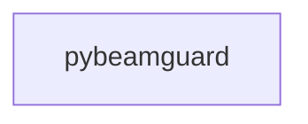

_Generated by CodeAtlas._

## Details

Owns 0 symbols across 0 file(s).

### pybeamguard

Owns 4 symbols across 2 file(s).

**Related Classes/Methods:** _None_

**Source Files:**

- `src/pybeamguard/cli.py`
  - `src.pybeamguard.cli._build_parser`
  - `src.pybeamguard.cli._cmd_analyze`
  - `src.pybeamguard.cli._severity_rank`
  - `src.pybeamguard.cli.main`
